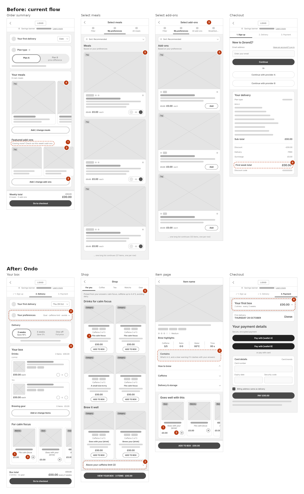

# Ondo

**Ondo** is a fictional caffeine subscription (coffee, tea, matcha and the gear to brew them).
The product brief: **build your first subscription box**, raising AOV and items per order in a new
customer's first box **without costing conversion**.

This repo is its design system and a demo shop built only from it, made **with Claude and code**
by [Mook (Puangpaka Rattana)](https://mooksportfolio.netlify.app/).

## Background: why this project exists

Ondo recreates a **take-home task from one of my job interviews**: a goal-based cross-sell on the
order summary of a food subscription's first box. I presented a working prototype on the day. This
repo rebuilds that proposal under an invented brand, and I did it for four reasons:

1. **To share the work openly.** The original used the company's brand, design system, products
   and Figma files, which aren't mine to publish. Ondo replaces all of it (name, logo, colours,
   type, catalogue, copy) so I can show the thinking without exposing anyone's brand or data.
2. **To keep the proposal, not the paint.** What I want to show is the product idea and how it was
   built: suggestions tied to the customer's goal, each with a reason; hard filters that are never
   ranked away; a rail that doesn't reshuffle while you add; the price always in view; and an
   A/B plan with conversion as the guard rail. All of that carries over to a caffeine
   subscription unchanged.
3. **To prove the design system, not just the screens.** Moving the same UI onto a brand-new
   palette and typeface (and changing both again mid-project) is a real test: if a screen only
   looks right in one brand, the brand was hard-coded somewhere. Here every visual value comes
   from one tokens file.
4. **To keep developing it.** A take-home stops at the presentation. As my own project I can carry
   on: checkout, delivery dates, dark mode, and whatever comes next, built with Claude and code.

Ondo is fictional and so are its products, prices and caffeine levels. The checkout is a demo:
nothing is charged and the Apple Pay and Google Pay buttons are static.

### Before and after

The original screens, redrawn as brand-free low-fi wireframes, next to the same screens in Ondo.
The orange numbers pair each problem with its fix; the **Story page** (`/story` in the app)
explains all six and why each one grows the box or protects conversion.



## What's in it

- **Tokens** in one file, themed by two attributes: `data-theme` (light / dark) and
  `data-category` (coffee / tea / matcha). One component, every look.
- **Components** documented in Storybook, every state in both themes, accessibility checks on.
- **Four mobile-first screens** built only from the system: *Your box* (order summary with a
  goal-based suggestion rail), *Shop* (tabs, unavailable items tucked away with a reason), an
  *item page* with brew highlights, and a demo *checkout*. Light and dark themes switch from the
  header.
- **A Story page** (`/story`) setting the original flow against Ondo, change by change.
- **AI guide**: `CLAUDE.md` + `doc/agent.md` keep AI-generated UI on-brand.

## Run it

```bash
npm install
npm run dev              # app at localhost:3000
npm run storybook        # design system at localhost:6006
npm test                 # recommendation rules and totals
npm run lint             # type-check
```

## Read more

| Doc | What's in it |
| --- | --- |
| [doc/design_system.md](doc/design_system.md) | Token layers, colour and contrast, type, components, states |
| [doc/prd.md](doc/prd.md) | Product, goals, recommendation rules, wording rules |
| [doc/architecture.md](doc/architecture.md) | Stack, structure, data model |
| [doc/agent.md](doc/agent.md) | Rules for AI coding tools and the definition of done |

## Credits

- Type: [Fira Sans](https://github.com/mozilla/Fira) (headlines) and
  [Source Sans 3](https://github.com/adobe-fonts/source-sans) (body), both under the SIL Open Font
  License (licences in `public/fonts`).
- Products, prices and caffeine levels are illustrative.
