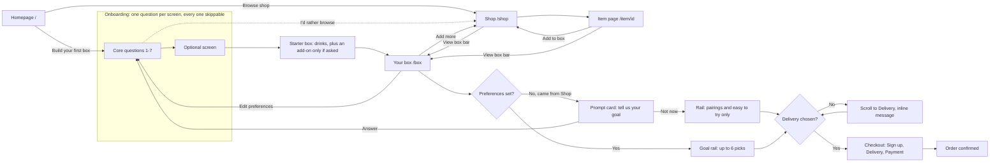

# Product Requirements: Build your first subscription box

> **Business goal:** raise AOV (average order value) and items per order in a new customer's
> first box **without costing conversion**.

Ondo is an invented caffeine subscription brand: coffee, tea, matcha, the gear to brew them, and
add-ons to go with them (bites and sweeteners).
This repo is a portfolio piece. It shows a design system built **with Claude and code**, and a
working page built only from that system.

The idea started from a meal-delivery take-home task (goal-based cross-sell). Ondo is a new brand and
a new domain, built from scratch, so none of that company's brand, tokens or content is used.

## Product overview

**What:** a subscription shop where customers pick how they want their day to feel, not just what
they like. The goal drives what Ondo suggests.

**Why a design system first:** coffee, tea and matcha each need their own character inside one
brand. That is a theming problem, and solving it in tokens (not by copying components) is the
main thing this project demonstrates.

## Problem the demo solves

Caffeine shoppers choose by product type ("I drink coffee"), so they rarely try the rest of the
range or the gear that goes with it. Most shops show the whole catalogue in one grid. Customers
already know *how* they want caffeine to fit their day; the shop doesn't ask.

## Goal

**Business goal:** raise AOV and items per order in a new customer's first box **without costing
conversion**.

**Customer goal:** build a first box that fits how they want their day to feel, quickly, with a
reason for every suggestion and the price always in view.

The two pull against each other: every extra suggestion is a chance to add an item and a chance to
make the box feel pushy or expensive. So each part of the design either **grows the box** or
**protects conversion**, and the second always wins a tie.

| Grows the box (AOV, items per order) | Protects conversion (the guard rail) |
| --- | --- |
| Goal-based rail: up to 6 suggestions, each with a one-line reason | Total, saving and cadence always visible (sticky bar on mobile, sidebar on desktop) |
| Pairings and "brews your…" gear, plus bites and sweeteners that go with a drink in the box: adds a second category | Hard filters: nothing above the caffeine limit or containing an avoid is ever suggested |
| "Easy to try" tasters (≤ £6) as a low-risk first add | Rail is hidden when nothing qualifies (no filler); it never reshuffles while you add |
| Shop "For you" tab uses the same rules | One tap to add, one tap to undo; the rail never pre-adds, and an add-on is only pre-added when the customer asked for one in onboarding |
| Subscription saving shown up front (10% every 15 days, 5% every 30 or 45) | One-off is always an option; nothing is pre-selected; "skip, swap or pause any time" next to the choice |
| Delivery suggestion says plainly when the box won't last as long as the most frequent delivery | The suggested frequency never switches the choice (and so the price) by itself |
| | Checkout shows the full breakdown, the delivery date and the terms in plain English before "Pay" |
| | No health claims on cards; goal language only in rail titles |

## Target user

People who drink caffeine daily, on mobile first, who are curious but busy. They don't need a
lesson in coffee; they want a sensible box and a reason for each suggestion.

## Customer goals (what the rail is tuned to)

| Goal id | Label | Typical picks |
| --- | --- | --- |
| `strong-start` | Strong morning start | Espresso blends, moka pot |
| `calm-focus` | Calm focus | Matcha, whisk and bowl set |
| `no-crash` | Afternoon without the crash | Green tea, oolong, cold-brew bottle |
| `cutting-down` | Cutting down | Half-caf, decaf, herbal blends |

## Scope

### In (v1)
1. **Design system:** tokens (light and dark theme, three category accents), core components,
   all documented in Storybook.
2. **Homepage** (`/`): the hero with two ways in, "Build your first box" (onboarding) and
   "Browse the shop". See [User flow](#user-flow).
3. **Your box** (`/box`): "Your preferences" (the core onboarding answers, as a summary with "Edit
   preferences"), one **Delivery** card (how often, with a suggestion worked out from the box, then
   the first delivery date), the box grouped into drinks and add-ons (gear, bites, sweeteners), each
   sub-grouped by category, a "For {goal}" rail of up to 6
   suggestions with a one-line reason each, and the box total always in view.
4. **Shop** (`/shop`): tabs For you · Coffee · Tea · Matcha · Gear · Bites · Sweeteners. "For you" runs
   the same rules as
   the rail. Coffee, Tea and Matcha have a one-tap caffeine filter (All · Low 0–2 · Medium 3 ·
   High 4–5; a band with nothing in it is disabled). The choice carries across the drink tabs; on a
   tab where that band is empty, everything shows. Items the customer can't have are tucked into
   collapsed sections with the reason.
5. **Item page** (`/item/[id]`): pack, description, caffeine, brew highlights, a "Contains" box that
   is never collapsed, brew guide, a "Goes well with this" rail and a pinned order bar.
6. **Checkout** (`/checkout`): progress steps (Sign up · Delivery · Payment), "Your first box"
   summary that expands to every line, subtotal, saving, free delivery and the total; first delivery
   date with a "Change" calendar (earliest slot tomorrow); Apple Pay / Google Pay; card form with
   inline validation; billing address; "Pay £…" button; plain-English subscription terms and
   reassurance. **Demo only: no payment is taken**, and the page says so.
7. **Light and dark themes**, switchable from the header on every page.
8. **AI guide:** `CLAUDE.md` + `doc/agent.md` so Claude Code (or any AI coding tool) builds
   on-brand by default.
9. **States:** empty rail, item over the customer's caffeine limit, out of stock, long names.

### Out
- Real payments (the checkout is a demo), accounts, a backend.
- Real product data or real caffeine figures (all values are illustrative).

### Next
- **Onboarding** (`/onboarding`) and the **starter box** are built: "Build your first box" on the
  Homepage opens it (see [Onboarding](#onboarding-build-your-first-box-next) and
  [Starter box](#starter-box)). Still to come: the preferences prompt on Your box (Path B), opening
  a single question from "Edit preferences", the "Keep in every delivery" toggle on first-box-only
  add-ons, the "left out" line, and Delivery starting unselected. Visiting Your box directly still
  starts from the sample customer in `src/data/customer.ts`.

## User flow

Two ways in, **one Your box page**. The paths differ only in how the box gets filled and whether
we know the customer's preferences yet. Preferences and Delivery are **cards on Your box**, not
separate steps, so neither path repeats a page and every route ends at the same checkout.



### Path A: Build your first box (guided)

1. **Homepage → Onboarding.** Core questions, then the optional screen (see
   [Onboarding](#onboarding-build-your-first-box-next)). "I'd rather browse" on any screen goes to
   the Shop with whatever was answered so far kept.
2. **Starter box.** Onboarding fills the box with drinks, picked by the same filter and score as
   the rail and sized to last about 30 days (see [Starter box](#starter-box)). They're labelled
   "Picked for you", and each can be removed or swapped in one tap.
3. **Add-ons only when asked.** If the customer said yes to "Add something to try with your cup?",
   the starter box also gets one bite and/or one sweetener that goes with their drinks, for the
   first box only. Otherwise add-ons reach the box only through the rail. The answer is the
   consent: pre-adding without it would raise AOV on paper, but a box that arrives fuller than
   asked feels pushy, repeats on every delivery and costs conversion.
4. **Your box** opens with preferences filled in and the goal rail.

### Path B: Browse the shop (self-serve)

1. **Homepage → Shop → Item page.** Add from the shop card or the item page; the "View box" bar
   shows the count and total and takes them to Your box.
2. **Your box without preferences.** The preferences card becomes a **prompt**: "Tell us your goal
   and caffeine limit for better picks". Answering opens onboarding and comes back to Your box with
   the box kept as it is (onboarding never replaces items the customer chose). "Not now" dismisses
   it for the session.
3. **Rail before preferences.** Only pairings with what's in the box and easy-to-try tasters, no
   goal score and no goal title ("Goes with your box"). The safe defaults still apply as hard
   filters (caffeine limit 3, no whole bean), but they only filter **suggestions**, never items the
   customer added. The Shop "For you" tab shows the same prompt instead of a ranking.

### Shared: Your box → Checkout

- **Delivery is a required choice.** No option is pre-selected; the suggested frequency is shown
  as a hint above the options. Tapping "Checkout" before choosing scrolls to the Delivery card
  and shows an inline message ("Choose how often, or one-off"); the button is never disabled
  without a reason.
- **Edit preferences** reopens onboarding at the question tapped and returns to Your box; the rail
  rebuilds from the current box (see [Editing answers later](#editing-answers-later)).
- **Add more** goes back to the Shop with the box kept.
- **Empty box** (every item removed): the rail is replaced by "Start with a drink" linking to the
  Shop, and Checkout is hidden.
- **Checkout:** Sign up · Delivery · Payment, then an order confirmation that repeats the first
  delivery date and the terms.

### Flow metrics

- Split of new customers by path (guided vs browse) and conversion of each to checkout.
- Path B: prompt answer rate, and AOV with vs without preferences.
- Checkout taps that hit the Delivery message (a sign the choice isn't clear enough).

## Onboarding: build your first box (next)

A short set of questions before the first box, so the box and the suggestions start from what the
customer told us. **A question earns its place only if the answer changes the box.** Anything that
doesn't is asked later or not at all, because every extra screen is a chance to drop off.

Onboarding starts from "Build your first box" on the Homepage (Path A in
[User flow](#user-flow)), or from the preferences prompt on Your box (Path B). There is no welcome
screen: the Homepage is the intro.

### Rules

- One question per screen (the optional screen is the only exception), each with a one-line
  reason under the question.
- Every question can be skipped. A skipped answer falls back to a safe default, never a guess
  that could break a hard filter.
- A progress bar throughout, and back works on every screen.
- "I'd rather browse" sits in the top bar on every screen: it goes to the Shop and keeps whatever
  was answered so far.
- Nothing moves on by itself: an answered screen shows "Next", an unanswered one "Skip". Auto-advancing
  hides the choice before it can be checked and makes a mis-tap cost a "Back".
- No budget question: the plan prices cover it, and asking up front feels like a sales question.
- Delivery frequency (or one-off) is chosen on Your box, not here. Questions 2 and 3 drive its
  suggestion (see [Delivery frequency](#delivery-frequency-your-box)).

### Screens

Eight screens: seven core questions, then one optional screen, then Your box.

| # | Question | Reason line | Answers | Input | If skipped | Field |
| --- | --- | --- | --- | --- | --- | --- |
| 1 | How do you want your day to feel? | "So we suggest things that fit your day." | Strong morning start · Calm focus · Afternoon without the crash · Cutting down | Four large cards, one choice | No goal: no goal score, rail title "Goes with your box" | `goal` |
| 2 | How many people drink it? | "So the box is the right size." | Just me · 2 · 3 · 4+ | One choice | 1 | `drinkers` |
| 3 | How many cups a day, each? | "So you don't run out between deliveries." | 1 · 2 · 3 · 4+ | One choice, with the live total | 2 | `cupsPerDay` |
| 4 | What do you drink now? | "So your first box starts with what you know." | Coffee · Tea · Matcha | Cards in the category accents, pick any | All types (the starter box then picks one drink) | `drinks` |
| 5 | What do you brew with? | "So we send beans and leaves you can brew." | Espresso machine · Filter · Moka pot · Cafetière · Teapot or infuser · Matcha whisk · Grinder · Nothing yet | Chips, pick any; "Nothing yet" clears the rest | No kit: ground, never whole bean | `brewKit` |
| 6 | What's your caffeine limit? | "We'll never suggest anything stronger." | 1 Very low · 2 Low · 3 Medium · 4 High · 5 Very high | The 1–5 caffeine meter from the product cards, with an example drink per level | 3 | `maxCaffeine` |
| 7 | Anything to avoid? | "We'll leave these out of everything we suggest." | Dairy · Nuts · Gluten · Soya · Sesame · None | Chips, pick any; "None" clears the rest | None | `avoids` |
| 8 | A few extras (optional) | "Optional, for better picks." | See [Optional screen](#optional-screen) | Two picture cards, then one row of chips; "Skip these" skips the whole screen; main button "Build my box" | All empty | `extras`, `taste` |

Screen notes:

- **Screens 2 and 3** are one person or several on purpose: cups are asked **per person**, and the
  screen shows the total ("That's 4 cups a day between you").
- **Screen 5** only shows kit for the drink types picked on screen 4 (a tea-only drinker doesn't see
  the espresso machine). "Nothing yet" is shown to everyone.
- **Screen 6** stays a 1–5 limit. A cut-off time ("nothing after 2pm") says *when* someone drinks
  caffeine, not *how much*, so it can't set a fair limit on its own.
- **Screen 7** offers every allergen the "Contains" box tracks (dairy, nuts, gluten, soya,
  sesame), so the avoid list can always filter bites and sweeteners as well as drinks.

### Optional screen

One screen, skippable as a whole, and kept short: it's the last screen, and a wall of questions
there makes "Skip these" the easy answer.

| Question | Answers | What it changes | Field |
| --- | --- | --- | --- |
| Add something to try with your cup? | A snack · A sweetener (picture cards, pick any; picking neither means no) and one line: "First box only. Remove it any time." | Adds one matching item per pick to the starter box, first box only (see [Starter box](#starter-box)); also +1 for that category in the rail | `extras` |
| What do you like the taste of? | Bright and fruity · Chocolatey and nutty · Smooth and mellow · Not sure | Picks the first coffee or tea when several fit; matched against `notes` | `taste` |

**Dropped (Oct 2026):** "Milk or black?" and "Stick or explore?". Nothing in the rules used them
yet, so they added reading without changing the box. Bring one back when a rule needs it (milk for
roast suggestions, explore for how far the rail strays from what they drink now).

### After the last screen

1. "Build my box" shows a short "Picking your drinks…" state, only as long as the work takes
   (never a fake delay).
2. Your box opens with the [starter box](#starter-box), the preferences card filled in and the rail.
3. From Path B (the customer already had items), the box they built is kept as it is: onboarding
   only fills the preferences and rebuilds the rail. It never replaces or adds to items they chose.

### Editing answers later

"Edit preferences" on Your box opens the screen for the answer tapped. "Done" goes back to Your
box instead of walking through the remaining screens. The rail rebuilds from the current box;
the starter box is never rebuilt, so edits don't swap items out from under the customer.

### How the answers feed the rules

Proposed additions to the recommendation rules once onboarding ships:

- **Hard filter:** never suggest gear the customer already owns (from `brewKit`).
- **Hard filter:** whole-bean coffee only if `brewKit` includes a grinder; otherwise send ground
  for their brew method. A grinder can be suggested on its own merits.
- **Score:** a drink that suits a brew method they own scores as "Brews with your …" (+1).
- **Score:** a coffee or tea whose `notes` match `taste` gets +1.
- **Score:** an add-on in a category they picked in `extras` gets +1. It still needs a pairing or
  the easy-to-try signal to reach the rail, so `extras` reorders add-ons but never sells one alone.
- **Consent:** `extras` is the only answer that can put an add-on in the box. Skipped, or neither
  card picked, means `extras` is empty and nothing is added.
- **Defaults when skipped:** goal none (no goal score), 1 drinker, 2 cups, all drink types,
  no brew kit (so ground, never whole bean), caffeine limit 3, no avoids.

Until then, drinks and brew kit are saved and shown in Your preferences but don't change the
suggestions yet.

### Data model

The answers are the `Customer` type (see [architecture.md](architecture.md)); a skipped goal is
`null`. `avoids` is a string list, so gluten and sesame need no type change. The optional answers
and the starter box's line fields:

```ts
interface Customer {
  // …core answers
  taste?: 'fruity' | 'chocolatey' | 'mellow';
  extras?: ('bites' | 'sweeteners')[];
}

interface BoxLine {
  // …existing fields
  pickedReason?: string;  // why the starter box picked it ("For calm focus")
  firstBoxOnly?: boolean; // true for add-ons pre-added from `extras`
}
```

### Ask later, not in onboarding

- How they heard about Ondo, and marketing consent: at checkout or after the first order.
- Ratings of what they drank: after the first box arrives. The best data for tuning suggestions,
  but it only exists once they've tasted something.

## Starter box

What onboarding puts in the box (Path A only). It reuses the rail's rules so there is one
recommendation system, not two. It holds drinks, plus at most one bite and one sweetener **only
when the customer asked for them**.

**Step 1: Filter**
- The same hard rules as the rail: nothing above `maxCaffeine`, nothing containing an avoid,
  nothing out of stock.
- Only the drink types in `drinks`.
- The form suits their kit: ground for their brew method; whole bean only if `brewKit` includes a
  grinder.

**Step 2: Score**, with the rail's signals: goal match +3, "Brews with your …" +1, taste match +1.
Ties go to the lower price (protects conversion).

**Step 3: Pick** the top-scoring drink **per drink type** in `drinks`, at most three. Three is the
most before the box stops feeling picked and starts feeling like a catalogue.

**Step 4: Size** to last about **30 days**, the middle cadence, so the delivery suggestion usually
agrees with the box:

1. Cups needed: drinkers × cups a day × 30, split evenly across the picked drinks.
2. Packs per drink: cups needed ÷ the drink's `cups`, rounded to the nearest whole pack, at least 1
   and at most 3.
3. The cap stops a large household getting a very expensive first box. Their delivery suggestion
   then says every 15 days (and that the box may run short), which is the honest answer.

**Step 5: Show** each line labelled "Picked for you" with the rail's reason wording ("For calm
focus", "Brews with your cafetière"), a quantity stepper and "Swap", which opens that drink's Shop
tab with the customer's filters applied.

**Step 6: Add-ons, only with consent.** For each category picked in `extras` (bites, sweeteners):

1. Filter: the rail's hard rules (avoids matter here, since bites carry allergens), and it must
   **pair** with a drink in the starter box.
2. Keep only easy-to-try items (≤ £6). If nothing qualifies, add nothing for that category; never
   add filler.
3. Pick the best pairing (ties to the lower price) and add **one**, quantity 1.
4. Mark it **first box only** (`firstBoxOnly`): it is not part of later deliveries unless the
   customer turns on "Keep in every delivery" on that line.
5. Show it in the add-ons group with its reason, never folded into a drink line: "Added because
   you asked for a snack · Goes with your Kyoto Ceremonial Matcha", a "First box only" label, the
   toggle and one-tap "Remove". The total includes it like any other line.

**Never in the starter box:** gear (pricier, and they may already own it), more than one item per
add-on category, or any add-on without a yes in `extras`.

**Fallbacks**
- `drinks` skipped: the single top-scoring drink across all types.
- A drink type with nothing that passes the filters is left out, with one line saying why ("No
  matcha under your caffeine limit").
- Nothing passes at all: the box is empty with "Start with a drink" linking to the Shop. A hard
  filter is never relaxed to fill the box.

**Taster packs** (`isSample`) never go in the starter box: they're the rail's easy first add, and
their few cups would make sizing meaningless.

**Worked example** (covered by tests in `starterBox.test.ts`). One person, 2 cups a day, drinks
coffee and matcha, brews with a filter, goal calm focus, caffeine limit 4, avoids dairy.

- Coffee: no coffee matches calm focus, and three brew with a filter (+1 each); the tie goes to the
  lowest price, Swiss Water Decaf. Matcha: Everyday Latte Matcha and Kyoto Ceremonial both match
  the goal (+3); the tie goes to Everyday, the cheaper.
- 60 cups needed, 30 per drink: Decaf (16 cups) × 2 and Everyday (25 cups) × 1 = 57 cups, 28 days,
  so the suggestion is every 30 days.
- Four people at 4 cups each would need 480 cups; the cap holds it at 3 packs per drink and the
  suggestion becomes every 15 days.
- With "A snack" and "A sweetener": Sesame Rice Crackers (pair with the Everyday matcha, £4),
  marked first box only. The vanilla syrup pairs too but costs more than £6, so no sweetener is
  added. With sesame also avoided, no bite is added either.

The lowest-price tie-break means a coffee drinker with no goal match can be given decaf. That
follows the rule as written (it protects conversion), but is worth revisiting with real data,
for example by breaking ties on caffeine closest to the customer's limit.

## Onboarding and starter box metrics

- Onboarding completion rate, and drop-off by screen (any screen losing more than a few percent is
  a candidate to move or cut).
- Skip rate per question, and how often "I'd rather browse" is used (and from which screen).
- Share of first boxes kept without changes (the starter box matched what they wanted).
- Swap rate and quantity changes per starter line: many reductions mean the 30-day sizing is too
  generous.
- Pre-added add-ons: share of customers saying yes to the extras question, removal rate before
  checkout (a high rate means the question isn't working as consent), and how many turn on "Keep in
  every delivery".
- Run pre-added add-ons as an A/B test against rail-only add-ons, with checkout conversion as the
  guard rail; ship only if AOV rises without conversion dropping past the agreed threshold.

## Delivery frequency (Your box)

One Delivery card: **how often**, then **the first delivery date**.

| Option | Saving |
| --- | --- |
| Every 15 days | 10% |
| Every 30 days | 5% |
| Every 45 days | 5% |
| One-off | None (full price) |

**Suggestion.** Worked out from the box and the preferences:

1. Cups in the box: each drink's cups per pack × quantity (gear makes none). Cups per pack are
   illustrative (`cups` in the catalogue).
2. Cups a day: people × cups a day each.
3. Days the box lasts: cups in the box ÷ cups a day, rounded down.
4. Suggest the frequency **closest to how long the box lasts**. If it lasts less than 15 days,
   suggest 15 days and say the box may run short.
5. No drinks in the box: no suggestion.

The suggestion is a hint, never a switch: the saving (and so the price) differs between options,
so changing it silently would move the total. It sits above the options, which are one tap away.

**Worked example** (covered by tests). Two Yirgacheffe Filter (16 cups each) + Kyoto Ceremonial
Matcha (15 cups) = 47 cups; the vanilla syrup adds none. One person, 2 cups a day: 23 days, so every
30 days. One cup a day: 47 days, so every 45 days. Two people, 2 cups each: 11 days, so every 15
days, and the box may run short. Five
Yirgacheffe and one Sencha (105 cups) for two people at 2 cups each: 26 days, so every 30 days.

**No default.** No option is selected when Your box first opens; the customer picks one before
checkout (see [User flow](#shared-your-box--checkout)).

**First delivery.** A date picker (earliest slot tomorrow, default a week ahead), then one line:
"Then every 15 days: next on Thu 19 Nov", or "Just this delivery" for a one-off.

## Recommendation rules (v1, rules-based)

Pairings and goal tags are **my own judgement** for the demo. In a real business a product or
tea/coffee specialist would own them; the code only reads them.

**Step 1: Filter (hard rules, never ranked away)**
- Remove anything above the customer's caffeine limit (`caffeineLevel` > `maxCaffeine`).
- Remove anything containing something the customer avoids (e.g. dairy, nuts).
- Remove anything out of stock.
- Remove anything already in the box.

**Step 2: Score**

| Signal | Points | Example |
| --- | --- | --- |
| Matches the goal | +3 | Ceremonial matcha → calm focus |
| Pairs with something in the box | +2 | Infuser mug next to sencha (an explicit pairing) |
| Brews something in the box | +1 | Cold-brew bottle for a tea that can be cold-brewed (gear only, when there's no explicit pairing) |
| Easy to try | +1 | Price ≤ £6 or a sample size |

Tie-break: lower price first. Show the top 6; zero scores are never shown. The reason line is the
pairing if there is one (most specific), otherwise the highest-scoring signal.

**Stable rail:** the rail is worked out from the box as it was when the page opened. Adding an
item from the rail turns its button into a stepper in place instead of reshuffling the cards.
Changing a preference rebuilds the rail from the current box.

**Worked example** (covered by tests). Goal: calm focus. Caffeine limit 4. Avoids dairy.
Box: 2 Yirgacheffe Filter, Kyoto Ceremonial Matcha, Vanilla Syrup. Top 6: Bamboo Whisk & Bowl Set
(5, "Goes with your Kyoto Ceremonial Matcha"), Matcha Taster Tin (4), Dark Chocolate Thins (3, "Goes
with your Kyoto Ceremonial Matcha"), Shizuoka Sencha (3), Tieguanyin Oolong (3), Everyday Latte
Matcha (3); ties go to the lower price. The espresso blends are over the caffeine limit, the chai and
the shortbread contain dairy and the grinder is out of stock, so none of them can appear.

## Add-ons

Everything that isn't a drink is an add-on, grouped in the box and the shop by category:

| Category | What | Examples |
| --- | --- | --- |
| Gear | Things to brew with | Moka pot, pour-over set, whisk and bowl, infuser mug, grinder |
| Bites | Something to eat with a cup | Almond biscotti, butter shortbread, oat cookies, dark chocolate, rice crackers |
| Sweeteners | Something to sweeten it | Demerara sugar, honey, vanilla syrup |

- Add-ons have no caffeine level and no goal tags. They reach the rail through a **pairing** with a
  drink in the box ("Goes with your Shizuoka Sencha") or as an easy first add (≤ £6), never through
  the goal, so a biscuit is never sold as good for focus.
- Only gear can "brew" a drink. Bites and sweeteners only pair.
- Bites and sweeteners are food, so their "Contains" box always lists the allergens we track (dairy,
  nuts, gluten, soya, sesame), or says there are none. Avoids work on them like on drinks.

## Wording rules

- Goal language ("For calm focus") goes in rail titles only.
- No health claims on product cards ("boosts focus", "burns fat"). Describe taste, origin, brew
  and caffeine level.
- Caffeine level is shown as a 1–5 meter with a text label, never as colour alone.

## Requirements

- Mobile first (402px frame), no sideways scroll at any width, two columns from 1024px.
- Every visual value comes from `src/styles/tokens.css`.
- The total always equals the sum of the lines.
- WCAG 2.2 AA contrast in both themes and all three accents.

## Success metrics (for a real launch, not the demo)

Measured on **new customers' first boxes**, in an A/B test against the box page without the rail.

- **Primary:** AOV and items per order.
- **Guard rail:** conversion from the box page to a started subscription (or a paid one-off), with a
  stop threshold agreed before the test (for example, a drop of more than 1–2 percentage points).
- **Secondary:** share of first boxes with more than one category (drinks + add-ons), subscription
  vs one-off mix.
- **Diagnostic:** rail impressions, add rate from the rail by position and reason, removals of
  rail-added items before checkout (a sign of regret), adds by category.
