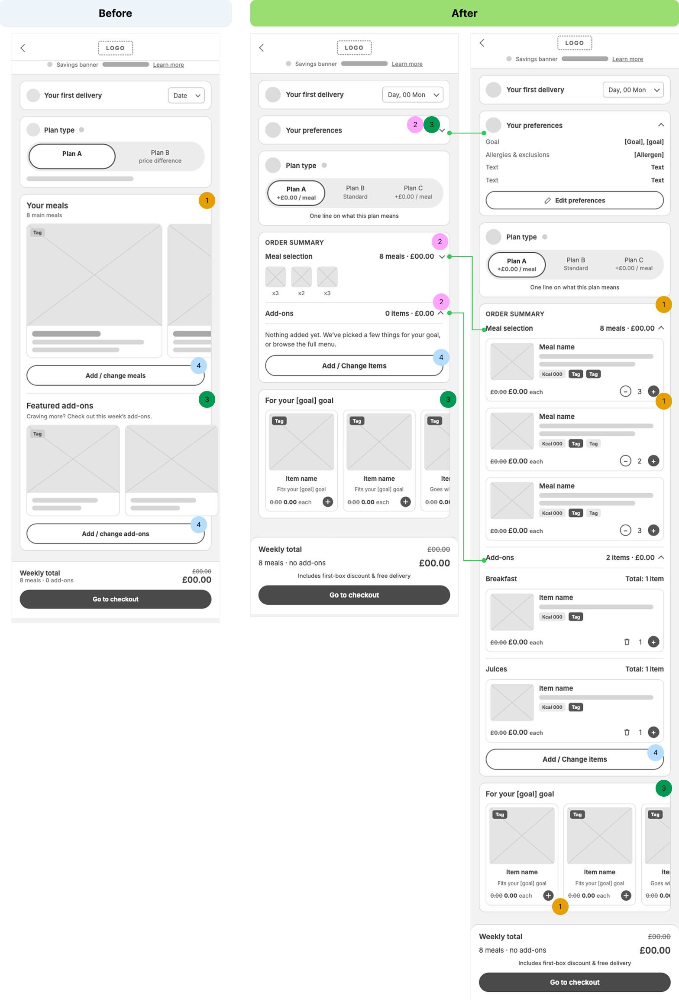
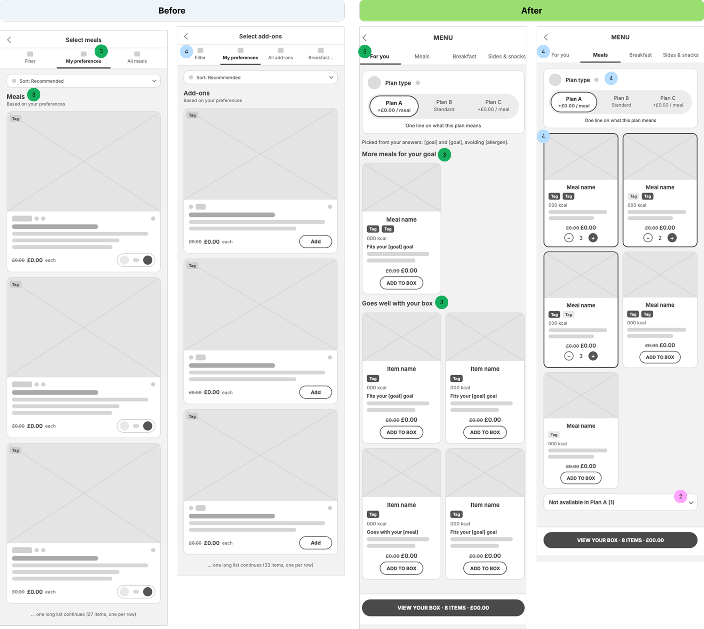
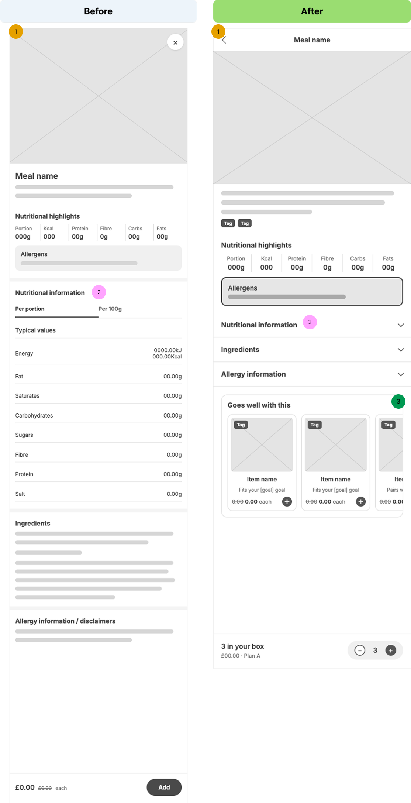
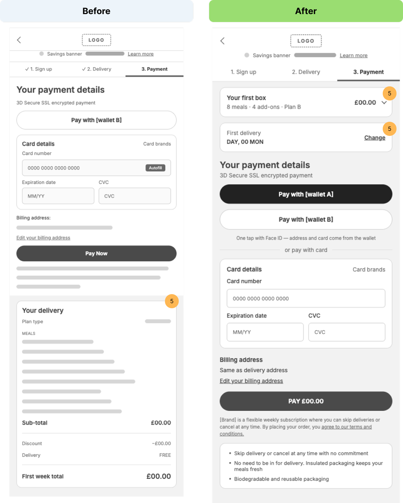

# The story: from a take-home task to Ondo

Ondo recreates a take-home task from one of my job interviews: the first box of a meal
subscription, where add-ons were easy to miss. This doc walks through the original flow and my
redesign, screen by screen, using brand-free low-fi wireframes. Ondo then rebuilds the same
proposal for a caffeine subscription.

## The brief

**Goal:** more items and a higher average order value (AOV) in a new customer's first box.

**Guard rail:** conversion. It's easy to lift basket size with upsells and lose the customer
entirely. When the two pull against each other, conversion wins.

the task also mentioned: 
- plan c will be added 
- add on menu catagories will be increase 

## What I found

The company's hunch was that the tabs buried the add-ons. My read: most people drop off before
they ever reach the tabs. Add-ons need to be where people already are and easy for them to add to basket

Five reasons add-ons weren't being added:

| | Problem | What it looks like |
| --- | --- | --- |
| A | They don't see it | Add-ons sit behind a button, a full-screen picker and tabs. |
| B | It doesn't feel relevant | A random juice doesn't connect to why they signed up. |
| C | Adding is effort | Open a picker, choose a tab, come back. |
| D | Misleading suggestion | Tap a suggested item to see its details, and it opens the full add-on menu instead. |
| E | Commitment worry | First box, on a subscription: does this repeat every week? |

## The principles

Every change serves one of four principles, and is checked against the guard rail. The numbers
on the wireframes are these principles, so the same number means the same thing on every screen.

| # | Principle | In one line |
| --- | --- | --- |
| 1 | **Recognised** | Use patterns customers already know from other apps (Jakob's Law). |
| 2 | **Compact** | Collapse what they've seen. Keep open what's new. |
| 3 | **Relevant** | Suggest by goal and box, and always say why. |
| 4 | **Scannable** | One menu for every category, grouped to scan. |
| 5 | **Guard rail** | Nothing extra between the customer and paying. |

---

## 1. Order summary

The page a new customer lands on after system build suggested box based on customer perferences. It's where the box is reviewed, and where
add-ons had to earn their place.

### Before

- **1 · Recognised.** "Your meals" is a sideways carousel of large photos. One meal is in view
  at a time, with no quantities, so the customer can't check their box at a glance.
- **4 · Scannable.** Two buttons, "Add / change meals" and "Add / change add-ons", lead to two
  separate full-screen pickers.
- **3 · Relevant.** "Featured add-ons" shows the same items to everyone, with one line for all:
  "Craving more? Check out this week's add-ons." It only starts after the meals and the button,
  so many people never scroll that far. Tapping a featured add-on opens the full add-on menu,
  not that item.

### After

The page opens compact, and expands one group at a time.

- **2 + 3 · Your preferences.** A collapsed card replays what the customer told us in
  onboarding: goal, allergies and exclusions. Opened, it lists them with "Edit preferences". It's
  compact, and it's the input behind every suggestion on the page.
- **2 · Compact.** The order summary collapses to a count, a price and thumbnails ("8 meals ·
  £00.00", x3 x2 x3). Add-ons collapse the same way. The whole box fits on one screen.
- **1 · Recognised.** Expanded, the box is a vertical list with quantity steppers, like the
  basket in every delivery app they already use. Add-ons are grouped by category (Breakfast,
  Juices) with their own totals.
- **3 · Relevant.** "For your [goal] goal" suggests items that fit the goal or pair with
  something in the box, and each card says why ("Fits your [goal] goal", "Goes with your
  [meal]"). An empty add-ons group says so plainly and points to the suggestions.
- **1 · Recognised.** Suggestions add in place with a + that turns into a stepper. No picker,
  no leaving the page. Tapping a suggestion opens that item's own details page.
- **4 · Scannable.** One "Add / Change items" button replaces the two, and opens the one menu.

The weekly total stays pinned to the bottom, with the first-box discount and free delivery.

### In Ondo

`/` (Your box): `PreferencesCard`, `OrderSummary`, `SuggestionRail` (up to 6 suggestions, each
with a reason) and `BoxTotal`.

---

## 2. Menu

Where customers browse everything they can add.

### Before

- **4 · Scannable.** Meals and add-ons are two separate pickers ("Select meals" and "Select
  add-ons"), each with its own tabs, sort and one large card per row: 27 meals and 33 add-ons
  in two long lists.
- **3 · Relevant.** "My preferences" and "Based on your preferences" exist, but nothing tells
  the customer which preference picked an item, or why.

### After

- **4 · Scannable.** One menu with sticky tabs: For you · Meals · Breakfast · Sides & snacks
  (and the rest of the categories). Cards sit in two columns, showing name, tags, kcal and
  was/now price. "Add to box" turns into a stepper on the card.
- **4 · Scannable.** Plan type sits at the top of the menu, with the price difference per meal
  and one line on what the plan means.
- **3 · Relevant.** "For you" comes first. It says what it's based on ("Picked from your answers:
  [goal] and [goal], avoiding [allergen]"), then "More meals for your goal" and "Goes well with
  your box", using the same rules as the order summary.
- **2 · Compact.** Switch plan and nothing silently disappears. Meals that aren't available on
  that plan are grouped and collapsed ("Not available in Plan A (1)").

A sticky "View your box · 8 items · £00.00" bar keeps the box and its total one tap away.

### In Ondo

`/shop` with tabs For you · Coffee · Tea · Matcha · Gear. Items the customer can't have (over
their caffeine limit, or containing something they avoid) sit in collapsed sections with the
reason.

---

## 3. Meal details

### Before: an overlay

In the original, tapping a meal opens its details as an **overlay on top of the menu**, not a
page of its own. The menu stays visible behind it, and it closes with a button on the photo.

The overlay holds a lot: the photo, description, nutritional highlights, allergens, a full
nutrition table (per portion and per 100g), ingredients, and allergy information and
disclaimers. Everything is open at once, so it's one long scroll inside a layer.

- **1 · Recognised.** A long scroll inside an overlay is hard to move around in, and the
  phone's back gesture leaves the menu behind rather than closing the meal.
- **2 · Compact.** The nutrition table, ingredients and disclaimers are all fully expanded, so
  the useful parts are pushed far down.

### After: a full page (my proposal)

Because the meal page holds so much information, I propose it opens as a **full page** in this
version.

- **1 · Recognised.** A full page with a back arrow and the meal name in the header. Back
  returns to the menu in the same place, and each meal has its own link.
- **2 · Compact.** Details on demand: nutritional highlights stay up front, then "Nutritional
  information", "Ingredients" and "Allergy information" are accordions, one tap away.
  **Allergens are the exception: always visible, never collapsed.**
- **3 · Relevant.** "Goes well with this" suggests items that pair with this meal or fit the
  goal, each with a reason and a + to add without leaving the page.

A pinned bar at the bottom shows how many are in the box, the price and plan ("3 in your box ·
£00.00 · Plan A"), with a stepper in place of the old "Add" button.

### In Ondo

`/item/[id]`: pack, description, caffeine, brew highlights, a "Contains" box that is never
collapsed, a brew guide, a "Goes well with this" rail and a pinned order bar.

---

## 4. Checkout

The last step: payment. Every change here protects conversion.

### Before

- **5 · Guard rail.** "Your delivery" (plan type, every meal, subtotal, discount, delivery and
  the first week's total) sits at the bottom of the page, below the Pay Now button. The customer
  enters card details before seeing what they're paying for.

### After

- **5 · Guard rail.** "Your first box" sits at the top: "8 meals · 4 add-ons · Plan B · £00.00",
  collapsed, with every line one tap away. What they're paying for is confirmed first.
- **5 · Guard rail.** The first delivery date is right below, with "Change", so the customer
  doesn't go back a step to check it.

Also on the payment step:

- Wallet payment first (Apple Pay / Google Pay): one tap with Face ID, no card to find and type.
  Card details stay available below "or pay with card".
- The button shows the amount: "Pay £00.00".
- The subscription terms in plain English (skip or cancel any time), and short reassurance below
  them.
- No extra steps before payment. I removed a "hot deals" page I'd sketched before checkout,
  because an extra step before payment is where people drop off.

### In Ondo

`/checkout`: progress steps, a "Your first box" summary that expands to every line, first
delivery date with a "Change" calendar, Apple Pay / Google Pay, the card form, "Pay £…" and
plain-English terms. It's a demo: no payment is taken.

---

## Summary

| Screen | Recognised (1) | Compact (2) | Relevant (3) | Scannable (4) | Guard rail (5) |
| --- | --- | --- | --- | --- | --- |
| Order summary | Box as a vertical list, steppers, add in place | Preferences, meals and add-ons collapse | Preferences replayed; suggestions for the goal, each with a reason | One "Add / Change items" route | Total pinned |
| Menu | | Unavailable items collapsed, never hidden | "For you" first, says what it's based on | One menu, tabs, two columns, plan type on top | "View your box" bar with the total |
| Meal details | Full page with back, not an overlay | Accordions for details on demand; allergens never collapsed | "Goes well with this" | | Box count and price pinned |
| Checkout | | Box summary collapsed | | | Summary and date before payment; wallet pay; total on the button |

Relevance is the thread that runs through every screen: the same rules (filter out anything the
customer can't have, then rank by goal, pairing and an easy first try) drive the order summary,
the "For you" tab and the meal page. The rules are in [prd.md](prd.md).

### How I'd prove it

- **Before building:** look at real data for new customers only (order summary → checkout →
  subscribed, split by iOS and Android), how many open the add-on picker today and what they add.
- **A/B test on new customers.** Primary: AOV and items per order. Guard rail: order summary →
  subscription conversion, with a stop threshold agreed up front.
- **What would change my mind:** AOV up and conversion flat, ship it. AOV up but conversion down
  past the threshold, stop and simplify. Conversion up but AOV flat, clarity works and relevance
  doesn't yet.
