# The story: from a take-home task to Ondo

This project has two parts.

- **Part 1: the take-home (2 days).** A take-home task from one of my job interviews: the first
  box of a meal subscription, where add-ons were easy to miss. I redesigned four screens as
  brand-free low-fi wireframes.
- **Part 2: three more days (Ondo).** I wanted to know if the proposal held up when it had to
  work, not just look right. So I rebuilt it as Ondo, an invented caffeine subscription, in code,
  and filled in the part the take-home skipped: how the first box gets built in the first place.

The goal is the same in both parts, and it's the thread through everything below:

> Raise AOV (average order value) and items per order in a new customer's first box, **without
> costing conversion**.

---

# Part 1: The take-home (2 days)

## The brief

**Goal:** more items and a higher average order value (AOV) in a new customer's first box.

**Guard rail:** conversion. It's easy to lift basket size with upsells and lose the customer
entirely. When the two pull against each other, conversion wins.

The brief also said a third plan (Plan C) and more add-on categories were on the way, so the
design had to make room for both.

## What I found

The company's hunch was that the tabs buried the add-ons. My read: most people drop off before
they ever reach the tabs. Add-ons need to be where people already are, and easy to add to the
basket.

Five reasons add-ons weren't being added:

| | Problem | What it looks like |
| --- | --- | --- |
| A | They don't see it | Add-ons sit behind a button, a full-screen picker and tabs. |
| B | It doesn't feel relevant | A random juice doesn't connect to why they signed up. |
| C | Adding is effort | Open a picker, choose a tab, come back. |
| D | Misleading suggestion | Tap a suggested item to see its details, and it opens the full add-on menu instead. |
| E | Commitment worry | First box, on a subscription: does this repeat every week? |

## The principles

Every change serves one of four principles, and is checked against the guard rail. The numbers
on the wireframes are these, so the same number means the same thing on every screen.

| # | Principle | In one line |
| --- | --- | --- |
| 1 | **Recognised** | Use patterns customers already know from other apps (Jakob's Law). |
| 2 | **Compact** | Collapse what they've seen. Keep open what's new. |
| 3 | **Relevant** | Suggest by goal and box, and always say why. |
| 4 | **Scannable** | One menu for every category, grouped to scan. |
| 5 | **Guard rail** | Nothing extra between the customer and paying. |

---

## 1. Order summary

The page a new customer lands on once the system has built a suggested box from their
preferences. It's where the box is reviewed, and where add-ons had to earn their place.

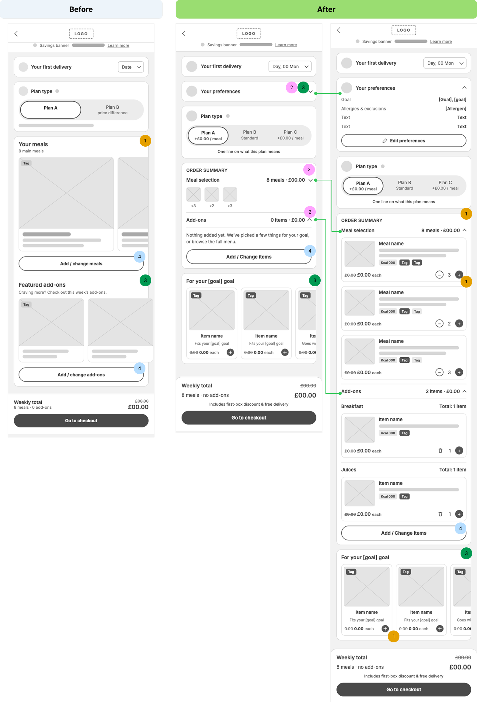

### Before

- **1 · Recognised.** "Your meals" is a sideways carousel of large photos. One meal is in view
  at a time, with no quantities, so the customer can't check their box at a glance.
- **4 · Scannable.** Two buttons, "Add / change meals" and "Add / change add-ons", lead to two
  separate full-screen pickers. *(A, C)*
- **3 · Relevant.** "Featured add-ons" shows the same items to everyone, with one line for all:
  "Craving more? Check out this week's add-ons." It only starts after the meals and the button,
  so many people never scroll that far. Tapping a featured add-on opens the full add-on menu,
  not that item. *(A, B, D)*

### After

The page opens compact, and expands one group at a time.

- **2 + 3 · Your preferences.** A collapsed card replays what the customer told us in
  onboarding: goal, allergies and exclusions. Opened, it lists them with "Edit preferences". It's
  compact, and it's the input behind every suggestion on the page.
- **2 · Compact.** The order summary collapses to a count, a price and thumbnails ("8 meals ·
  £00.00", x3 x2 x3). Add-ons collapse the same way. The whole box fits on one screen.
- **1 · Recognised.** Expanded, the order summary is a vertical list with quantity steppers,
  like the basket in every delivery app they already use. Add-ons are grouped by category
  (Breakfast, Juices) with their own totals.
- **3 · Relevant.** "For your [goal] goal" suggests items that fit the goal or pair with
  something in the box, and each card says why ("Fits your [goal] goal", "Goes with your
  [meal]"). An empty add-ons group says so plainly and points to the suggestions. *(A, B)*
- **1 · Recognised.** Suggestions add in place with a + that turns into a stepper. No picker,
  no leaving the page. Tapping a suggestion opens that item's own details page. *(C, D)*
- **4 · Scannable.** One "Add / Change items" button replaces the two, and opens the one menu.

The weekly total stays pinned to the bottom, with the first-box discount and free delivery.

---

## 2. Menu

Where customers browse everything they can add.

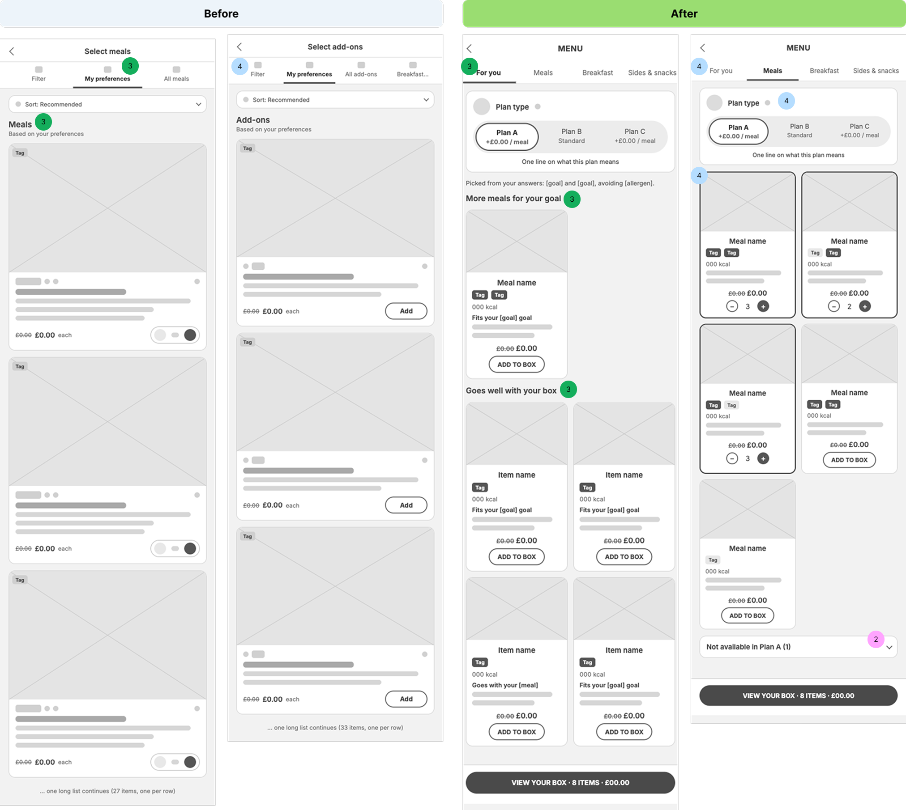

### Before

- **4 · Scannable.** Meals and add-ons are two separate pickers ("Select meals" and "Select
  add-ons"), each with its own tabs, sort and one large card per row: 27 meals and 33 add-ons
  in two long lists. *(A, C)*
- **3 · Relevant.** "My preferences" and "Based on your preferences" exist, but nothing tells
  the customer which preference picked an item, or why. *(B)*

### After

- **4 · Scannable.** One menu with sticky tabs: For you · Meals · Breakfast · Sides & snacks
  (and the rest of the categories). Cards sit in two columns, showing name, tags, kcal and
  was/now price. "Add to box" turns into a stepper on the card. New categories become new tabs,
  so the menu grows without a redesign.
- **4 · Scannable.** Plan type sits at the top of the menu, with the price difference per meal
  and one line on what the plan means. A Plan C is one more option here.
- **3 · Relevant.** "For you" comes first. It says what it's based on ("Picked from your answers:
  [goal] and [goal], avoiding [allergen]"), then "More meals for your goal" and "Goes well with
  your box", using the same rules as the order summary.
- **2 · Compact.** Switch plan and nothing silently disappears. Meals that aren't available on
  that plan are grouped and collapsed ("Not available in Plan A (1)").

A sticky "View your box · 8 items · £00.00" bar keeps the box and its total one tap away.

---

## 3. Meal details

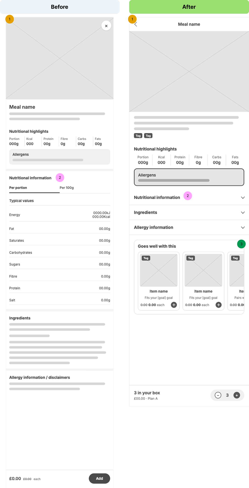

### Before: an overlay

In the original, tapping a meal opens its details as an **overlay on top of the menu**, not a
page of its own. The menu stays visible behind it, and it closes with a button on the photo.

The overlay holds a lot: the photo, description, nutritional highlights, allergens, a full
nutrition table (per portion and per 100g), ingredients, and allergy information and
disclaimers. Everything is open at once, so it's one long scroll inside a layer.

- **1 · Recognised.** A long scroll inside an overlay is hard to move around in, and the
  phone's back gesture leaves the menu behind rather than closing the meal.
- **2 · Compact.** The nutrition table, ingredients and disclaimers are all fully expanded, so
  the useful parts are pushed far down.

### After: a full page

Because the meal page holds so much information, I propose it opens as a **full page**.

- **1 · Recognised.** A full page with a back arrow and the meal name in the header. Back
  returns to the menu in the same place, and each meal has its own link.
- **2 · Compact.** Details on demand: nutritional highlights stay up front, then "Nutritional
  information", "Ingredients" and "Allergy information" are accordions, one tap away.
  **Allergens are the exception: always visible, never collapsed.**
- **3 · Relevant.** "Goes well with this" suggests items that pair with this meal or fit the
  goal, each with a reason and a + to add without leaving the page. *(B, C)*

A pinned bar at the bottom shows how many are in the box, the price and plan ("3 in your box ·
£00.00 · Plan A"), with a stepper in place of the old "Add" button.

---

## 4. Checkout

The last step: payment. Every change here protects conversion.

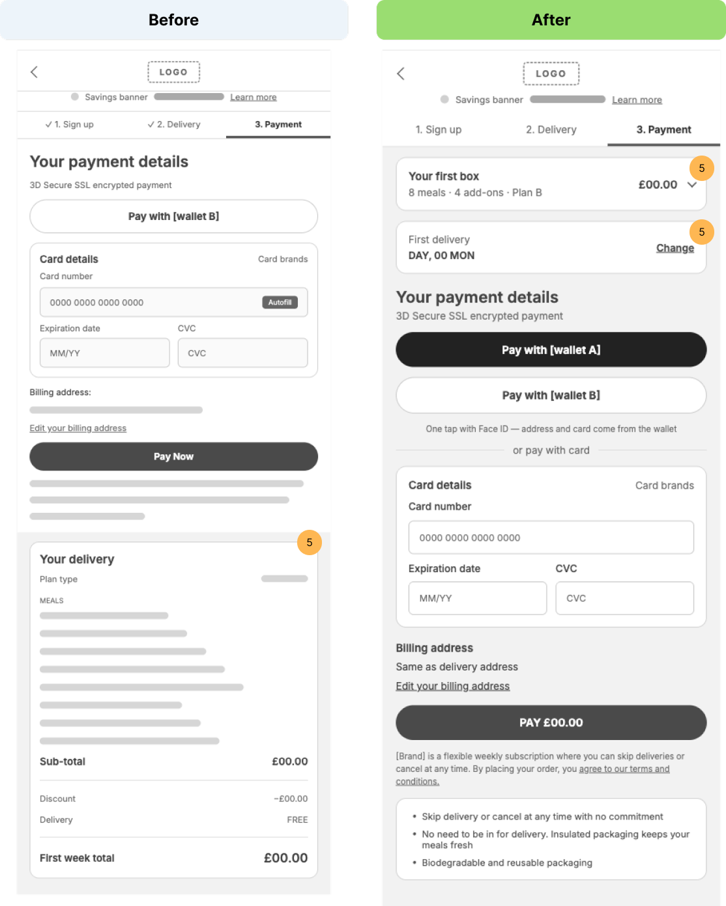

### Before

- **5 · Guard rail.** "Your delivery" (plan type, every meal, subtotal, discount, delivery and
  the first week's total) sits at the bottom of the page, below the Pay Now button. The customer
  enters card details before seeing what they're paying for.

### After

- **5 · Guard rail.** "Your first box" sits at the top: "8 meals · 4 add-ons · Plan B · £00.00",
  collapsed, with every line one tap away. What they're paying for is confirmed first.
- **5 · Guard rail.** The first delivery date is right below, with "Change", so the customer
  doesn't go back a step to check it.

Also on the payment step:

- Wallet payment first (Apple Pay / Google Pay): one tap with Face ID, no card to find and type.
  Card details stay available below "or pay with card".
- The button shows the amount: "Pay £00.00".
- The subscription terms in plain English (skip or cancel any time), and short reassurance below
  them. *(E)*
- No extra steps before payment. I removed a "hot deals" page I'd sketched before checkout,
  because an extra step before payment is where people drop off.

---

## Summary of Part 1

| Screen | Recognised (1) | Compact (2) | Relevant (3) | Scannable (4) | Guard rail (5) |
| --- | --- | --- | --- | --- | --- |
| Order summary | Box as a vertical list, steppers, add in place | Preferences, meals and add-ons collapse | Preferences replayed; suggestions for the goal, each with a reason | One "Add / Change items" route | Total pinned |
| Menu | | Unavailable items collapsed, never hidden | "For you" first, says what it's based on | One menu, tabs, two columns, plan type on top | "View your box" bar with the total |
| Meal details | Full page with back, not an overlay | Accordions for details on demand; allergens never collapsed | "Goes well with this" | | Box count and price pinned |
| Checkout | | Box summary collapsed | | | Summary and date before payment; wallet pay; total on the button |

Relevance is the thread that runs through every screen: the same rules (filter out anything the
customer can't have, then rank by goal, pairing and an easy first try) drive the order summary,
the "For you" tab and the meal page.

### How I'd prove it

- **Before building:** look at real data for new customers only (order summary → checkout →
  subscribed, split by iOS and Android), how many open the add-on picker today and what they add.
- **Then an A/B test on new customers:** AOV and items per order, with conversion as the guard
  rail and a stop threshold agreed up front. The full plan, and what each result would mean, is
  in [prd.md](prd.md#success-metrics-for-a-real-launch-not-the-demo).

---

# Part 2: Three more days (Ondo)

The take-home answered *where add-ons should go*. It left two questions open:

1. **Does it work, or only look right?** Wireframes don't show what happens when a suggestion
   doesn't fit, a box is empty, or someone taps Back at the wrong moment.
2. **Where does the first box come from?** The order summary starts from "a box the system
   built from their preferences". The take-home never showed how.

So I rebuilt the proposal as Ondo, a caffeine subscription (coffee, tea, matcha, gear, bites and
sweeteners), in code. A new brand and a new domain, so nothing from the original company is
used. The rules behind every screen are in [prd.md](prd.md); this part is about the decisions.

## 1. A design system first

Coffee, tea and matcha each need their own character inside one brand. That's a theming problem,
so I solved it in tokens rather than by copying components: one set of components, three drink
accents, light and dark themes, all documented in Storybook. Every screen is built only from the
system, and an AI guide (`CLAUDE.md`, `doc/agent.md`) keeps new work on-brand.

## 2. The Part 1 screens, built

| Take-home screen | In Ondo |
| --- | --- |
| Order summary | Your box (`/box`) |
| Menu | Shop (`/shop`), with For you, a tab per drink, Gear, Bites and Sweeteners |
| Meal details | Item page (`/item/[id]`) |
| Checkout | Checkout (`/checkout`), a demo: no payment is taken |

Building them surfaced things the wireframes couldn't: Back has to return to the list the
customer came from (not walk through every item they opened), and an empty box needs something
to start from, so a new visitor sees best sellers instead of a blank page.

## 3. Onboarding: where the first box comes from

Eight short questions: how they want their day to feel, how many people, cups a day, what they
drink now, what they brew with, a caffeine limit, anything to avoid, and an optional "a few
extras". It's built to be easy to leave, because a long form is where people give up:

- **Every question can be skipped.** A skipped answer falls back to a safe default, never a
  guess that could break a limit.
- **"I'd rather browse" is always there**, and keeps what was answered so far.
- **Nothing moves on by itself.** Next or Skip, so a mis-tap never costs a step.
- It still feels like the brand: a progress cup that fills, glasses that pour for the caffeine
  limit, brew kit that draws itself in.

## 4. The starter box: choice, not size

This is the decision I'm most sure of. A bigger basket only counts if the order goes through: an
abandoned £40 box is worth less than a paid £25 one, and a big first price is where orders get
lost. So:

- **The starter box stays small.** One drink per type they drink (at most three), sized to last
  about **15 days**, our most frequent delivery, with at most 3 packs a drink. I first sized it to
  30 days, then cut it: AOV per box goes down, but what a customer spends a month stays about the
  same, and the first price is much easier to say yes to.
- **Ties go to the cheaper item.** Sometimes that puts decaf in front of a coffee drinker: a known
  cost, accepted for a lower first price.
- **Add-ons only when asked.** If they say yes to bites or a sweetener, one goes in, £6 or under,
  first box only, and easy to remove. Otherwise the box grows through the suggestions they choose.
- **Keep it, if they want it.** With a subscription, every bite and sweetener has a "Keep in every
  delivery" switch, off by default. Turning it on asks once ("Add to your subscription?", with the
  price and a reminder they can change it any time), and the total shows both prices: the first box,
  then what every delivery after costs. That's AOV beyond the first box, but only from what the
  customer chose to keep.

So AOV grows by *choice* (rails, opt-in add-ons), not by making the starting box bigger. That's
also the answer to problem **E**: nothing extra repeats unless they keep it.

## 5. One set of rules for every suggestion

Your box, the shop's For you tab and the item page all use the same rules: filter out anything
over their caffeine limit, containing something they avoid, out of stock, or kit they already own;
then rank by goal, pairing with their box and an easy first try. Every suggestion says why. No
snacks are suggested before there's a drink in the box, because a biscuit on its own isn't a
reason to subscribe.

## 6. Nothing chosen for them

- **Browsing without answering works.** No limits are applied to what they haven't told us, and a
  "Tell us a little about you" prompt sits next to the best sellers instead of a wall.
- **Delivery starts empty.** The card suggests how often from what's in the box (and says when the
  box may run short), but never picks. Tapping checkout too early opens Delivery and says why,
  instead of a disabled button.
- **A reload keeps everything**, including a placed order, so the confirmation never turns back
  into a payment form.

## 7. The unhappy paths

The last step was the user flow: every board shows the main path and the edge cases, and tags
which steps grow the box (**+ AOV**) and which protect conversion (**Conversion**).

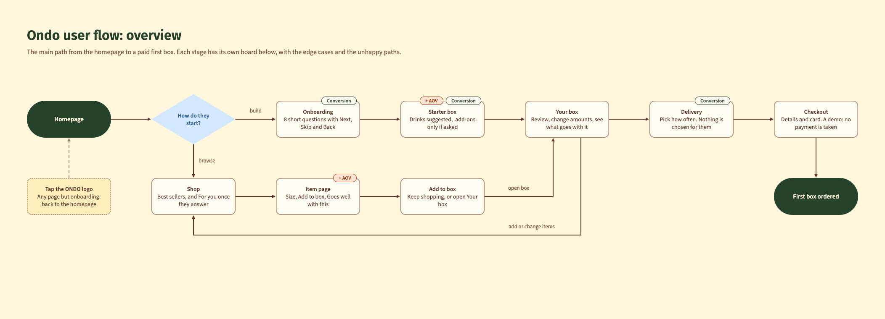
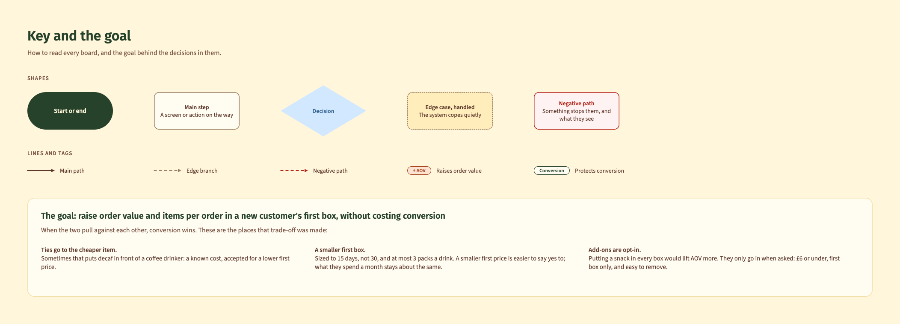
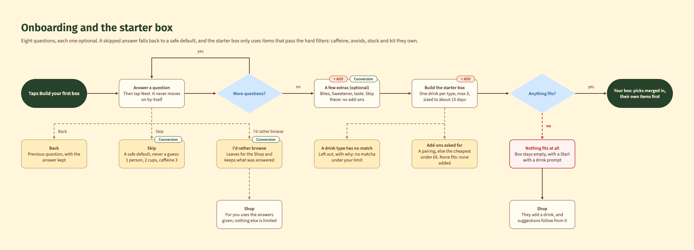
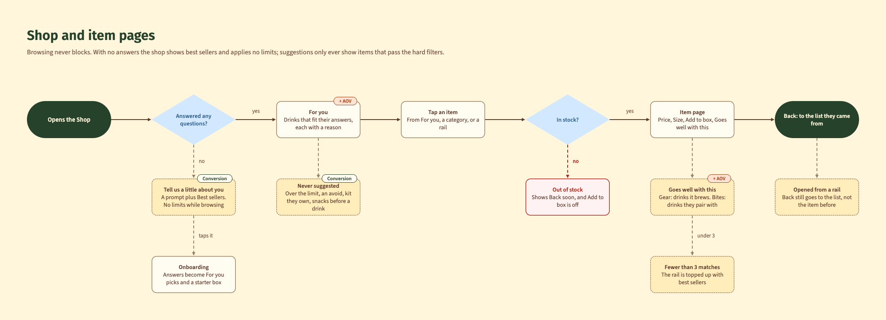
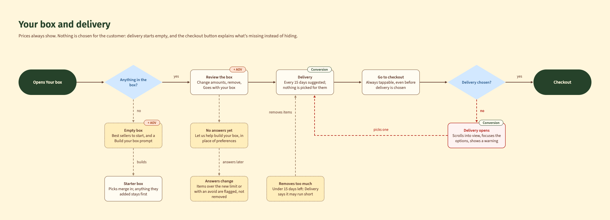
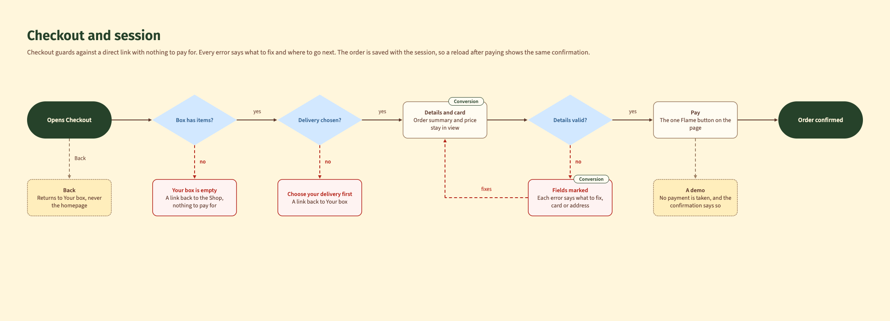
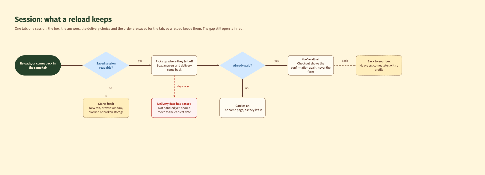
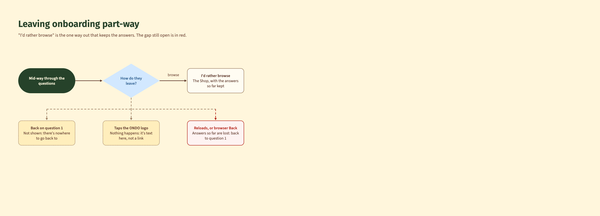

Two gaps are still open, and marked in red: a saved delivery date that has passed by the time
they come back, and answers lost if onboarding is reloaded mid-way.

## What's next

- **Test it with five people**, onboarding to checkout, watching the first price and the
  suggested add-ons.
- **Close the two red gaps.**
- **Measure it** as in [prd.md](prd.md#success-metrics-for-a-real-launch-not-the-demo): AOV and
  items per order on paid orders, always next to conversion.
